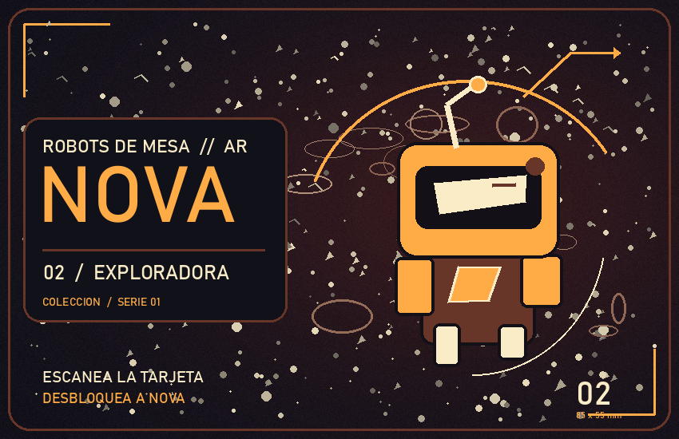
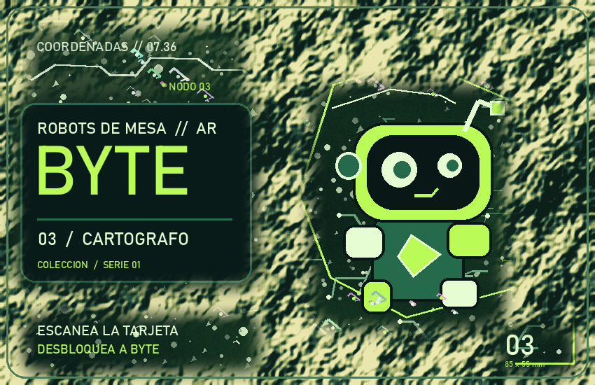

# Robots de Mesa AR

Prototipo de realidad aumentada para Android. Colocá a Milo sobre una mesa real, hacelo saludar, sentarse o caminar, y desbloqueá a Nova y Byte con sus tarjetas.

Video de demostración: [**https://youtu.be/ajDBEc3wSNU**](https://youtu.be/ajDBEc3wSNU)

## Probar en Android

1. Abrí la aplicación
2. Aceptá el permiso de cámara. Mové el celular despacio sobre una mesa iluminada y tocá el plano marcado para colocar a Milo.
3. Elegí un robot desde la colección de arriba o tocándolo en la mesa. Su botón abajo a la derecha abre los comandos. **Moverse** lo hace caminar por varios puntos dentro de la superficie detectada.
4. En **Herramientas**, elegí un cubo, una pelota o un rectángulo. Toca el plano para colocar la pieza, y arrastrá para levantarla. **Limpiar** retira todas las piezas de herramientas.

## Tarjetas de la colección

Para desbloquear otros robots, mostrá las tarjetas impresas o desde otra pantalla. Ponela sobre la mesa y apuntá con la cámara. Cuando la app la reconozca, el robot se desbloquea en la colección. Tocá su pestaña y después una zona del plano para colocarlo.

   
  <em>Tarjeta de Nova</em>

   
  <em>Tarjeta de Byte</em>

